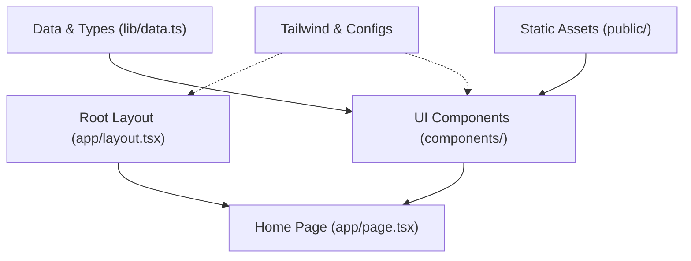

# Project Architecture & Folder Guide

Welcome to the **Shahi Trader's Website** codebase. This project is built using **Next.js 15 (App Router)**, **React 19**, **TypeScript**, and **Tailwind CSS**, with **Framer Motion** for animations.

This document explains the architecture of the project and the exact role of every folder and configuration file.

---

## Architecture Overview

---

## Directory Breakdown

### 1. `app/` (Next.js App Router)
The `app/` directory uses the Next.js App Router convention for routing, page rendering, layout composition, and global styling.

* **`layout.tsx`**: The Root Layout component wrapping every page. It initializes the Google Inter font (`next/font/google`), sets metadata (SEO, page title, OpenGraph tags), and injects global styles.
* **`page.tsx`**: The main entry point for the homepage (`/`). It composes all individual section components (Hero, About, Services, Featured Projects, etc.) inside a smooth page transition wrapper.
* **`loading.tsx`**: A fallback UI displayed while route content is streaming or compiling.
* **`globals.css`**: Defines Tailwind directives (`@tailwind base`, `@tailwind components`, `@tailwind utilities`), CSS variables, color palettes, and global animations.

---

### 2. `components/` (Reusable UI Components)
This directory houses all React components. Each file is self-contained and focuses on a single responsibility:

#### Navigation & UX Helpers
* **`Navbar.tsx`**: Sticky top navigation bar with mobile drawer menu, smooth anchor scrolling, and quick action buttons.
* **`ScrollProgress.tsx`**: Visual scroll progress indicator at the top of the browser viewport.
* **`BackToTop.tsx`**: Floating button that appears when scrolling down to quickly return to the top.
* **`PageTransition.tsx`**: Framer Motion container managing enter/exit transitions and scroll resets.

#### Landing Page Sections
* **`Hero.tsx`**: Hero banner featuring primary headline, key value proposition, animated badges, and direct call-to-action buttons.
* **`About.tsx`**: Company history, mission, vision, and core values.
* **`CapabilityBand.tsx`**: Ribbon showcasing key organizational strengths, standards, and operational competencies.
* **`Services.tsx` & `ServiceCard.tsx`**: Overview grid of infrastructure offerings (highways, power lines, street lighting, civil poles).
* **`FeaturedProjects.tsx` & `ProjectCard.tsx`**: Portfolio showcase with project metrics, completion stats, and image previews.
* **`Stats.tsx` & `AnimatedCounter.tsx`**: Numerical milestones (kilometers covered, poles installed, projects completed) with smooth count-up animations.
* **`WhyChooseUs.tsx`**: Key differentiators including safety records, government approvals, and turnaround times.
* **`Gallery.tsx`**: Photo grid highlighting past projects on-site with an interactive lightbox viewer.
* **`Testimonials.tsx`**: Testimonials from infrastructure clients, partners, and municipal contractors.
* **`Contact.tsx`**: Interactive contact form with input validation demo, direct contact cards, and map placeholder.
* **`Footer.tsx`**: Comprehensive footer with quick links, copyright, compliance info, and contact info.
* **`SectionHeading.tsx`**: Standardized reusable heading component maintaining visual consistency across sections.

---

### 3. `lib/` (Utilities, Types & Data Layer)
* **`data.ts`**: Centralized source of truth for all content displayed on the frontend:
  * TypeScript interfaces (`Stat`, `Service`, `Project`, `TimelineItem`, `Testimonial`).
  * Structured mock data arrays for services, portfolio items, milestones, certifications, and contact details.
  * Icon mappings using `lucide-react`.

---

### 4. `public/` (Static Assets)
* Contains publicly served static files (e.g., custom images, logos, icons, `favicon.ico`, `robots.txt`).
* Files placed in this folder are served directly from the root URL (e.g., `public/logo.png` is accessible at `/logo.png`).

---

### 5. `.vercel/` (Vercel Project Link)
* Stores project linkage information for automated Vercel CLI deployments (`projectId`, `orgId`, `projectName`).
* Excluded from version control via `.gitignore`.

---

### 6. `.next/` (Next.js Build Output)
* Automatically generated by Next.js during `npm run dev` and `npm run build`.
* Stores compiled serverless bundles, cached assets, and static pages.
* Excluded from version control.

---

### 7. `node_modules/` (Dependencies)
* Contains all installed npm/pnpm packages (React, Next.js, Tailwind CSS, Lucide icons, Framer Motion, etc.).
* Excluded from version control.

---

## Configuration Files

| File | Purpose |
| :--- | :--- |
| **`next.config.ts`** | Next.js configuration (remote image hostnames, compiler options). |
| **`tailwind.config.ts`**| Tailwind CSS design tokens, custom colors, animations, and breakpoint definitions. |
| **`postcss.config.js`** | PostCSS setup to process Tailwind CSS utilities and Autoprefixer. |
| **`tsconfig.json`** | TypeScript compiler flags, path aliases (`@/*` pointing to project root). |
| **`package.json`** | Project scripts, dependencies, devDependencies, and metadata. |
| **`pnpm-lock.yaml`** | Deterministic lockfile tracking exact package versions. |
| **`.eslintrc.json`** | Code quality and linting rules using Next.js ESLint presets. |
| **`.gitignore`** | Excludes build artifacts, secrets, and caches from git. |

